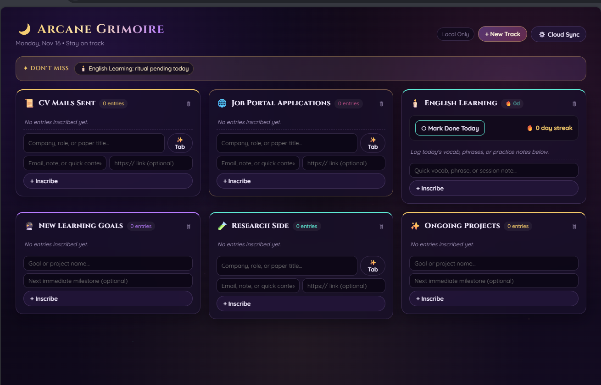
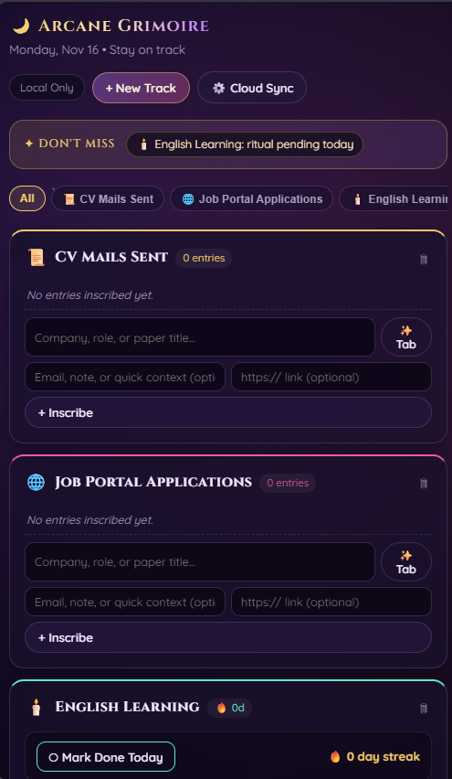

<div align="center">

# 🌙 Arcane Grimoire

### *A Dark-Fantasy Daily Productivity Dashboard & Docked Browser Widget*

[](https://developer.chrome.com/docs/extensions/mv3/intro/)
[](#installation-chrome--brave)
[](#tech-stack--architecture)
[](#firebase-cloud-sync-setup)

*Track job applications, daily rituals, research pipelines, and ongoing projects without ever leaving your browser.*

[Features](#-enchanted-features) • [Preview](#-preview) • [Architecture](#-tech-stack--architecture) • [Installation](#-installation-chrome--brave) • [Cloud Sync](#-firebase-cloud-sync-setup)

</div>

---

## ✨ Why Arcane Grimoire?

Desktop widgets usually end up buried behind browser windows. **Arcane Grimoire** lives directly inside **Chrome and Brave** in two synchronized forms:

1. **Full Dashboard (`New Tab`)** — Opens instantaneously (`0ms` local cache) every time you press `Ctrl + T`, giving you a full panoramic view of your day.
2. **Docked Widget (`Side Panel`)** — Stays pinned beside Gmail, LinkedIn, job portals, or research papers so you can log updates and grab URLs without switching tabs.

Designed with an **obsidian midnight glassmorphism** aesthetic—blending twilight amethyst, starlight gold, mystic rose, and potion emerald accents over a subtle starfield.

---

## 🖼️ Preview


| Full New Tab Dashboard | Docked Side Panel Widget |
| :---: | :---: |
|  |  |

---

## 🔮 Enchanted Features

* **✦ "Don't Miss" Oracle Alert Strip** — Automatically surfaces pending daily habits and flags job applications or CV emails that have gone **7+ days** without a reply so you never miss a follow-up.
* **✨ 1-Click Tab Grab** — Clicking `✨ Tab` inside any log card reads your currently open browser tab and auto-fills both the title and URL straight into your tracker.
* **🕯️ Daily Ritual Streaks** — Built-in streak engine for recurring daily habits (like English learning) alongside a quick-capture log for vocabulary or session notes.
* **🌙 Conjure Unlimited Custom Tracks** — Create new topics anytime in three flexible modes:
  * **Entry Log** — Status-cycling pills, links, notes, and optional follow-up timers.
  * **Progress & Milestones** — Live `0–100%` sliders with next-milestone notes.
  * **Daily Ritual** — One-click daily completion toggle with streak counter.
* **⚡ Live Cross-View Sync** — Uses `chrome.storage.onChanged` so any update in the Side Panel reflects immediately in every open New Tab (and vice versa).
* **☁️ Cross-Browser Cloud Sync** — Optional Firebase Authentication + Firestore sync keeps Chrome, Brave, and multiple devices seamlessly aligned while keeping local cache speed instant.

---

## 📜 Default Pre-Configured Tracks

| Track | Tracking Mode | Built-In Workflow |
| :--- | :--- | :--- |
| 📜 **CV Mails Sent** | Entry Log | `Sent` → `Follow-up` → `Interview` → `Replied` → `Closed` (7-day alert) |
| 🌐 **Job Portal Applications** | Entry Log | `Applied` → `Follow-up` → `Interview` → `Offer` → `Closed` (7-day alert) |
| 🕯️ **English Learning** | Daily Ritual | Daily check-off, active streak counter, and vocab/phrase log |
| 🔮 **New Learning Goals** | Progress Bar | `0–100%` progress slider + immediate next milestone |
| 🧪 **Research Side** | Entry Log | `Idea` → `Reading` → `Drafting` → `Submitted` + 1-click paper URL grab |
| ✨ **Ongoing Projects** | Progress Bar | `0–100%` progress tracker + next action notes |

---

## 🛠️ Tech Stack & Architecture

Built strictly **zero-build** and **100% Manifest V3 compliant**—no bundlers, no external CDN scripts blocked by MV3 CSP policies, and zero runtime overhead.

* **Core:** Vanilla HTML5, CSS3 (Glassmorphism & CSS Grid), ES6+ JavaScript
* **Extension APIs:** `chrome.sidePanel`, `chrome.storage.local`, `chrome.storage.onChanged`, `chrome.tabs`
* **Cloud Backend:** Native `fetch()` integration with **Firebase Auth REST API** (`identitytoolkit`), automatic token refresh (`securetoken`), and **Cloud Firestore REST API**
* **Typography:** `Cinzel` (arcane display headings) & `Quicksand` (clean readable body)

### Folder Structure

```text
arcane-grimoire/
├── manifest.json       # MV3 configuration (New Tab override, Side Panel, permissions)
├── background.js       # Configures extension toolbar icon to toggle Side Panel
├── newtab.html         # Full-screen New Tab dashboard shell
├── sidepanel.html      # Compact vertical Side Panel widget shell
├── styles.css          # Dark fantasy glassmorphism theme & responsive layout
├── firebase-sync.js    # Firebase Auth, token renewal, and Firestore REST sync module
└── app.js              # State engine, Oracle alerts, streak math, custom tracks & UI
```

---

## 🚀 Installation (Chrome & Brave)

Because Brave and Chrome share the Chromium engine, the exact same extension loads cleanly into both:

1. **Clone the repository**
   ```bash
   git clone [https://github.com/Sbasnayaka/arcane-grimoire.git](https://github.com/Sbasnayaka/arcane-grimoire.git)
   ```
2. Open your browser's Extensions page:
   * **Brave:** `brave://extensions`
   * **Chrome:** `chrome://extensions`
3. Toggle **Developer mode** **ON** in the top-right corner.
4. Click **Load unpacked** and select the cloned `arcane-grimoire` folder.
5. Open a **New Tab (`Ctrl + T`)** to launch the full dashboard, and **pin the Arcane Grimoire icon** to your toolbar to toggle the docked Side Panel from any webpage.

---

## ☁️ Firebase Cloud Sync Setup

Arcane Grimoire works offline out of the box using `chrome.storage.local`. To sync across browsers or machines with Firebase Firestore:

1. Create a free project in the [Firebase Console](https://console.firebase.google.com/).
2. Enable **Authentication → Sign-in method → Email/Password**.
3. Create a **Firestore Database** in **Production Mode**.
4. Apply these **Firestore Security Rules** so only your authenticated account can read or write your dashboard data:

```javascript
rules_version = '2';
service cloud.firestore {
  match /databases/{database}/documents {
    match /users/{userId}/{document=**} {
      allow read, write: if request.auth != null && request.auth.uid == userId;
    }
  }
}
```

5. Copy your **Project ID** and **Web API Key** from **Project Settings → General**.
6. Click **⚙️ Cloud Sync** inside the extension, enter your credentials, and click **Create Account** (first device) or **Sign In** (any additional browser).

> **Security Note:** No API keys, credentials, or personal tokens are hardcoded in this repository—every user enters their own Firebase config privately at runtime inside local extension storage.

---

## 🗺️ Future Spells (Roadmap)

- [ ] Daily target rings (e.g., daily CV / application goal counter)
- [ ] Keyboard shortcut (`Alt + G`) to summon/dismiss the Side Panel from any tab
- [ ] One-click JSON export & import backup
- [ ] Custom background themes & animated lunar phase header
- [ ] Drag-and-drop track reordering

---

## 👩‍💻 Author & License

Crafted with ✨ by **[Sbasnayaka](https://github.com/Sbasnayaka)**.

Released under the **MIT License** — feel free to fork, customize the aesthetic, and conjure your own tracks.
